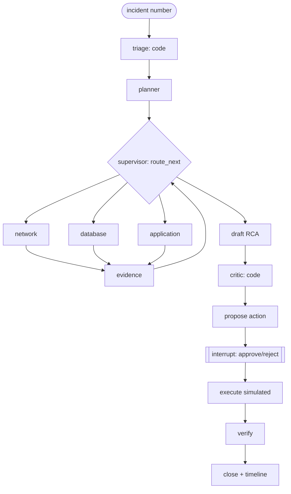

# Incident Commander — mock-first slice (offline, synthetic Acme Retail Ltd)

> Paste plan: see `files/P4-incident-commander.md` in the study project.
> AGENTS.md is copied to repo root.

## What it is

Given an incident number, an agent triages, investigates with stub MCP tools,
drafts an evidence-backed RCA (HIGH/MEDIUM/LOW), pauses for human approval,
runs only allow-listed simulated actions, verifies, and exports a timeline.

## Run in 1 command

```powershell
uv sync --group dev
uv run pytest -q
uv run uvicorn incident_commander.api:app --port 8000
# open http://localhost:8000 — pick incident, Start run, Approve/Reject
```

Scenario with approval (API):

```powershell
$run = (Invoke-RestMethod -Method Post http://localhost:8000/runs `
  -ContentType "application/json" -Body '{"incident_number":"INC001"}').run_id
Invoke-RestMethod http://localhost:8000/runs/$run | ConvertTo-Json -Depth 6
Invoke-RestMethod -Method Post http://localhost:8000/runs/$run/approve `
  -ContentType "application/json" -Body '{"decided_by":"manager","comment":"go"}'
```

Eval (5 scenarios x2, agent vs workflow):

```powershell
uv run python scripts/eval_5scenarios.py
# writes reports/eval_agent_vs_workflow.json
```

## Architecture



## Metrics (from `reports/eval_agent_vs_workflow.json`)

5 scenarios x 2 runs each (synthetic Acme, mock costs, offline).
`uv run python scripts/eval_5scenarios.py`.

| mode | runs | RCA accuracy | red-herring avoided | avg evidence coverage | avg steps | avg USD |
|---|---|---|---|---|---|---|
| agent graph | 10 | 1.00 | 1.00 | 0.75 | 7.0 | 0.07 |
| fixed workflow | 10 | 0.40 | 0.80 | 1.00 | 6.0 | 0.06 |

Reading: the agent wins on correctness (it routes to the right specialist and
names the red herring as a herring); the workflow always calls all 4 tools
(coverage 1.00) but blames the most recent change, so it falls for INC002 and
misses INC003/INC004 specifics. The agent stops early once evidence is
sufficient, hence slightly lower coverage but higher accuracy.

## Failure demos

- Loop: force same tool 3x → `loop breaker: same tool called 3x in a row`, status `escalated`.
- Timeout: `get_logs` raises (simulated) → recorded in `errors[]`, run continues or escalates.
- Rejection: POST `/reject` → RCA saved as work note only, no action executed.
- Red herring (INC002): agent blames packet loss, marks css deploy a herring; baseline blames chg-102.
- Restart-resume: kill server while `waiting_approval`, restart, `GET /runs/{id}` + approve works (JSON checkpointer).

## Trade-offs / limits

- Mock LLM (deterministic RCA templates); real LLM + LangGraph + Postgres + Langfuse deferred.
- JSON files are last-writer-wins; fine offline, not for concurrent prod use.
- Costs are mock (`usd_per_step`); verify prices before any live spend.
